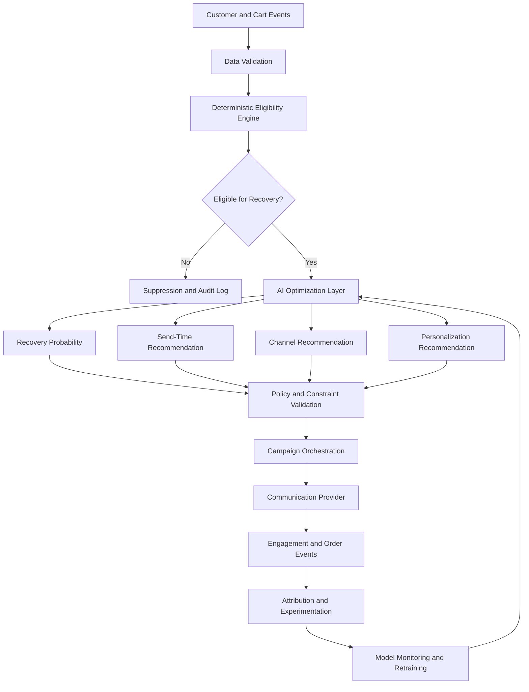

# CartRecover — AI Strategy and Optimization Roadmap

## 1. Objective

CartRecover currently uses deterministic business rules to identify abandoned carts, evaluate recovery eligibility, enforce customer consent, apply communication frequency limits, schedule campaigns, and attribute eligible conversions.

The next stage is to introduce AI-assisted optimization to improve recovery performance.

The objective is not to replace the existing business-rule engine with machine learning. Instead, AI should improve prioritization, timing, channel selection, personalization, and anomaly detection while mandatory compliance and operational constraints remain deterministic.

The primary business goal is to maximize incremental recovered revenue while minimizing unnecessary communication and customer fatigue.

## 2. Where AI Fits in the Architecture

The proposed architecture separates mandatory business decisions from predictive optimization.



The eligibility engine acts as a hard boundary. A model cannot authorize communication when consent is missing, a cart is already purchased, or a frequency limit has been reached.

## 3. AI Use Case 1 — Cart Recovery Prediction

### Business problem

Not every abandoned cart has the same probability of conversion.

Some customers may return and complete checkout without receiving a reminder. Others may need a recovery campaign.

Treating all abandoned carts equally can waste communication resources and increase customer fatigue.

### Proposed approach

Train a supervised classification model to estimate:

**Probability that an eligible abandoned cart converts within a defined prediction window.**

Potential features:

| Feature | Description |
|---|---|
| Cart value | Total monetary value of the cart |
| Item count | Number of products in the cart |
| Product category | Category of products in the cart |
| Session duration | Time spent during the shopping session |
| Time since last activity | Inactivity duration |
| Previous purchases | Customer purchase history |
| Previous recovery engagement | Historical clicks and conversions |
| Historical cart behavior | Frequency of abandonment and checkout completion |
| Channel engagement | Previous email and SMS engagement |

### Candidate models

- Logistic Regression as an interpretable baseline.
- Random Forest for nonlinear relationships.
- XGBoost or LightGBM for structured tabular data.

### Model output

```json
{
  "cart_id": "CART-EXAMPLE-001",
  "conversion_probability": 0.72,
  "model_version": "recovery-model-v1",
  "prediction_window_hours": 24
}
```

The probability is an illustrative example, not a prediction produced by the current implementation.

### Evaluation

- ROC-AUC.
- Precision and recall.
- PR-AUC for imbalanced data.
- Brier score and calibration.
- Conversion rate by prediction-score segment.

A high conversion probability does not necessarily mean the customer needs a recovery message. The customer may have purchased anyway.

For that reason, predictive conversion scoring should not be confused with incremental treatment-effect estimation.

## 4. AI Use Case 2 — Send-Time Optimization

### Business problem

Customers interact with communication channels at different times.

Sending all recovery messages at the same fixed time may reduce engagement.

### Proposed approach

Estimate the time window in which a customer is most likely to engage with a recovery message.

Potential features:

- Customer timezone.
- Previous open and click timestamps.
- Day of week.
- Hour of day.
- Communication channel.
- Previous campaign engagement.
- Customer activity patterns.

### Candidate approaches

- Historical engagement frequency analysis.
- Logistic regression for time-window response prediction.
- Gradient-boosted classification.
- Time-series or survival-analysis approaches when sufficient history exists.

### Output

```json
{
  "customer_id": "CUS-EXAMPLE-001",
  "recommended_channel": "EMAIL",
  "recommended_time": "2026-11-02T10:00:00",
  "confidence": 0.81
}
```

This is an illustrative recommendation.

The scheduling system must still enforce consent, frequency limits, and quiet hours. An AI recommendation is never permission to bypass these controls.

## 5. AI Use Case 3 — Channel Optimization

### Business problem

A customer may respond better to email than SMS, while another customer may prefer SMS.

A fixed channel strategy may fail to account for these differences.

### Proposed approach

Estimate the expected response or incremental treatment effect for each permitted channel.

Potential methods:

- Logistic regression.
- Gradient-boosted models.
- Contextual multi-armed bandits.
- Controlled channel experiments.

### Important constraint

Channel selection must only consider channels for which valid customer consent exists.

If email consent is granted but SMS consent is withdrawn, the system must not recommend SMS as an actionable option.

### Evaluation

Compare channel performance using:

- Delivery rate.
- Click-through rate.
- Conversion rate.
- Unsubscribe or opt-out rate.
- Incremental revenue per eligible customer.

Channel comparisons should account for differences in customer populations. Raw conversion rates alone can produce misleading conclusions.

## 6. AI Use Case 4 — Personalization

### Business problem

Generic recovery messages may not be relevant to every customer.

A personalized message can improve engagement when it reflects the customer's actual cart and permitted business context.

### Proposed approach

Use customer and cart information to select or generate approved message content.

Potential personalization attributes:

- Product names.
- Cart value.
- Product category.
- Approved promotional offers.
- Campaign objective.
- Customer's preferred language, where available.

### Example

Generic message:

"Your cart is waiting. Complete your purchase today."

Personalized message:

"You left running shoes in your cart. Return to your cart to complete your order."

### Controls

- Use only verified cart and product data.
- Never invent discounts, inventory availability, or product claims.
- Respect channel-specific content restrictions.
- Validate generated messages against approved templates and brand guidelines.
- Avoid exposing sensitive customer information.

For an initial production version, template selection with controlled variable substitution is safer than unrestricted message generation.

## 7. AI Use Case 5 — Anomaly Detection

### Business problem

Data inconsistencies and unusual operational behavior can affect customer experience, compliance, and revenue reporting.

The current validation script uses deterministic checks. Machine learning could complement these checks by identifying unusual patterns that are difficult to capture with fixed thresholds.

### Potential detection areas

- Unusual spikes in suppression rates.
- Sudden increases in bounce rates.
- Abnormal campaign conversion patterns.
- Unexpected changes in cart values.
- Unusual customer communication frequency.
- Suspicious attribution patterns.
- Changes in model input distributions.

### Candidate approaches

- Statistical process control.
- Isolation Forest.
- Clustering-based anomaly detection.
- Time-series anomaly detection.

Machine-learning anomaly detection should supplement, not replace, explicit database constraints and compliance checks.

## 8. Most Important Opportunity — Incremental Recovery Optimization

A conventional conversion model predicts whether a customer is likely to purchase.

However, this is not the same as predicting whether sending a recovery message will cause the purchase.

For example:

- Customer A has an 85% chance of purchasing without a reminder.
- Customer B has a 25% chance of purchasing without a reminder but a 60% chance after a reminder.

A model that only predicts purchase probability may prioritize Customer A, even though Customer B could offer greater incremental campaign value.

### Proposed solution: Uplift modeling

Estimate the difference between the probability of conversion with a recovery intervention and the probability without one.

\[
Uplift(x) = P(Y=1 \mid T=1, X=x) - P(Y=1 \mid T=0, X=x)
\]

Where:

- \(Y\) represents conversion.
- \(T=1\) represents receiving a recovery intervention.
- \(T=0\) represents the control condition.
- \(X\) represents customer and cart characteristics.

### Experiment design

1. Identify eligible abandoned carts.
2. Randomly assign eligible customers to treatment and control groups.
3. Send recovery campaigns only to the treatment group.
4. Continue normal business behavior for the control group.
5. Measure conversions within a predefined window.
6. Compare conversion and revenue outcomes.
7. Estimate incremental impact and uncertainty.

### Primary metrics

- Incremental conversion lift.
- Incremental revenue per eligible customer.
- Incremental profit after communication and discount costs.
- Opt-out rate.
- Customer complaint rate.

This is the preferred long-term optimization strategy because it connects model decisions to actual business impact.

## 9. Model Development and Evaluation Lifecycle

A production model should follow a controlled development process.

### Stage 1 — Data preparation

- Build historical customer and cart features.
- Define prediction targets precisely.
- Prevent future information from entering training features.
- Handle missing and inconsistent values.
- Separate training, validation, and test datasets by time where appropriate.

### Stage 2 — Baseline development

Start with interpretable baselines before complex models.

For example:

- Logistic Regression for conversion prediction.
- Simple historical engagement statistics for send-time recommendations.
- Randomized experiments for channel comparisons.

### Stage 3 — Model evaluation

Evaluate predictive performance and business performance separately.

A model can achieve strong classification metrics while generating little incremental business value.

### Stage 4 — Shadow deployment

Run the model alongside the existing rule-based system without allowing its predictions to influence customer communication.

Compare recommendations with actual outcomes.

### Stage 5 — Controlled rollout

Introduce model recommendations to a limited eligible population.

Maintain a control group and monitor customer and business outcomes.

### Stage 6 — Monitoring and retraining

Monitor:

- Prediction quality.
- Calibration.
- Feature drift.
- Data quality.
- Conversion performance.
- Incremental lift.
- Channel-level performance.
- Customer opt-outs and complaints.

Retraining should be triggered by measured performance degradation or meaningful changes in business behavior, not merely by a fixed calendar schedule.

## 10. AI Governance and Guardrails

The following rules must remain deterministic:

1. Customer consent.
2. Cart purchase and lifecycle status.
3. Communication frequency limits.
4. Quiet-hour restrictions.
5. Valid campaign and template configuration.
6. Provider dispatch eligibility.
7. Attribution integrity.

AI models may recommend actions only within these constraints.

Every model recommendation should include:

- Model version.
- Prediction timestamp.
- Input feature version.
- Recommendation.
- Confidence or score.
- Final policy decision.
- Outcome where available.

This creates traceability and supports model monitoring and auditability.

## 11. Implementation Roadmap

| Phase | Capability | Priority |
|---|---|---|
| Phase 1 | Recovery probability model | High |
| Phase 2 | Send-time optimization | High |
| Phase 3 | Channel optimization | Medium |
| Phase 4 | Personalization | Medium |
| Phase 5 | Anomaly detection | Medium |
| Phase 6 | Uplift modeling and experimentation | Strategic priority |

The order is a proposed implementation sequence, not a claim that these capabilities are already implemented.

## 12. Current Status

| Capability | Status |
|---|---|
| Deterministic recovery eligibility | Implemented |
| Consent validation | Implemented |
| Frequency caps | Implemented |
| Campaign scheduling | Implemented |
| Click-based attribution | Implemented |
| Analytics endpoint | Implemented |
| Data validation | Implemented |
| Recovery prediction model | Proposed |
| Send-time optimization model | Proposed |
| Channel optimization model | Proposed |
| AI personalization | Proposed |
| ML anomaly detection | Proposed |
| Uplift modeling | Proposed |

No machine-learning model is currently trained or deployed in CartRecover.

## 13. Conclusion

The AI strategy for CartRecover focuses on measurable business optimization rather than adding machine learning without a clear purpose.

Deterministic rules protect customer consent and operational correctness. Predictive models can improve prioritization, timing, and personalization. Controlled experimentation and uplift modeling can determine whether recovery campaigns generate incremental business value.

The long-term objective is to build a system that does not simply send more recovery messages, but identifies the right eligible customer, selects the most appropriate intervention, and measures the actual incremental impact.