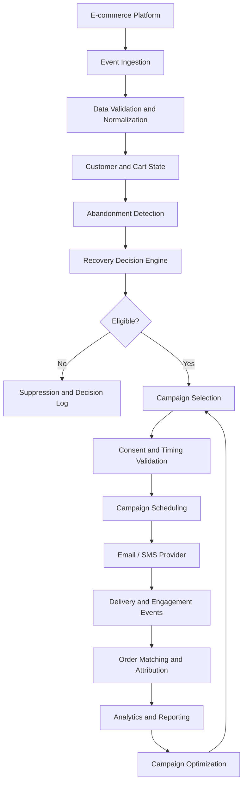

# CartRecover — Solution Design

## 1. Executive Summary

CartRecover is a data-driven cart recovery system designed to help e-commerce businesses identify abandoned shopping carts, determine whether customers can be contacted, coordinate recovery campaigns, and measure the resulting conversions.

The system addresses a business problem that is more complex than simply sending reminder messages. A reliable recovery workflow must account for customer consent, cart lifecycle, contact frequency, campaign eligibility, communication timing, customer engagement, and purchase attribution.

The current implementation provides a working backend prototype with synthetic data, rule-based recovery decisions, campaign scheduling, attribution logic, validation checks, and automated tests.

The proposed production architecture extends this foundation with real-time event ingestion, scalable orchestration, analytics, and AI-assisted optimization.

## 2. Business Problem

E-commerce businesses lose potential revenue when customers add products to their carts but leave without completing checkout.

However, contacting every customer with an abandoned cart is neither effective nor compliant.

A recovery system must answer five operational questions:

1. **Is the cart genuinely abandoned?** A cart may still be active, recently updated, or already purchased.
2. **Can the customer be contacted?** Consent must be valid for the selected communication channel at the time of evaluation.
3. **When should the customer be contacted?** Frequency caps and quiet hours must be respected.
4. **Which campaign should be used?** Campaigns and message templates must match the channel and business objective.
5. **Did the communication generate a conversion?** Orders must be attributed using valid engagement events and a defined attribution window.

The objective is to recover incremental revenue while avoiding unnecessary, duplicate, or unauthorized communication.

## 3. Solution Objectives

### Primary objectives

- Identify carts that meet the abandonment criteria.
- Evaluate customer eligibility before scheduling a recovery message.
- Enforce channel-specific consent.
- Prevent excessive communication through frequency caps.
- Respect quiet hours.
- Select an eligible campaign and message template.
- Maintain a traceable record of every recovery decision.
- Attribute eligible purchases to recovery communications.
- Detect data inconsistencies and operational anomalies.

### Success metrics

| Metric | Definition |
|---|---|
| Abandonment rate | Abandoned carts / eligible carts |
| Recovery rate | Recovered abandoned carts / abandoned carts |
| Send eligibility rate | Eligible recovery decisions / evaluated carts |
| Suppression rate | Suppressed attempts / evaluated carts |
| Delivery rate | Delivered messages / sent messages |
| Click-through rate | Clicked messages / delivered messages |
| Conversion rate | Attributed orders / sent messages |
| Attributed revenue | Revenue assigned to recovery messages |
| Incremental recovery lift | Conversion rate in treatment group minus conversion rate in control group |

A key distinction is that attributed revenue is not automatically incremental revenue. A customer may have purchased without receiving a recovery message. A randomized holdout group is required to estimate the actual incremental impact.

## 4. Proposed System Architecture

### High-level workflow



### Component responsibilities

| Component | Responsibility |
|---|---|
| Event ingestion | Receive cart, session, customer, consent, order, and message events |
| Data validation | Validate identifiers, timestamps, relationships, and monetary values |
| Cart state management | Maintain the current lifecycle state of each cart |
| Abandonment detection | Identify carts that have crossed the inactivity threshold |
| Recovery decision engine | Evaluate eligibility and explain the decision |
| Campaign orchestration | Select campaigns, templates, and schedule recovery attempts |
| Communication adapter | Integrate with email and SMS providers |
| Event tracking | Capture delivery, bounce, open, and click events |
| Attribution engine | Associate eligible orders with recovery messages |
| Analytics | Report operational and business performance |
| Optimization layer | Improve targeting, timing, channel, and campaign selection |

## 5. Cart Lifecycle and Abandonment Logic

A cart should not be considered abandoned merely because it exists without an order.

The proposed lifecycle is:

- **ACTIVE:** The customer is still interacting with the cart or the inactivity threshold has not elapsed.
- **ABANDONED:** The cart has exceeded the configured inactivity threshold without a completed purchase.
- **PURCHASED:** The customer completed checkout.
- **RECOVERED:** A previously abandoned cart resulted in a qualifying recovery purchase.

The current prototype uses a configurable abandonment threshold of 180 minutes.

Conceptually:

```python
is_abandoned = (
    cart.status == "ACTIVE"
    and evaluated_at - cart.updated_at >= abandonment_threshold
    and not completed_order_exists
)
```

The cart lifecycle must be updated from reliable events rather than inferred only from a scheduled database scan.

A production implementation should also handle late-arriving events and out-of-order updates. For example, a purchase event may arrive after an abandonment evaluation. The system must reconcile the cart state and prevent a recovery message from being sent after checkout.

## 6. Recovery Decision Engine

The recovery decision engine is the central business-rule component.

It evaluates a cart before a communication attempt is scheduled.

### Eligibility checks

1. The cart must exist.
2. The cart must meet the abandonment criteria.
3. The cart must not already be purchased or recovered.
4. No completed order may already exist for the cart.
5. The customer must have active consent for the selected channel.
6. The customer must not exceed the 24-hour frequency cap.
7. The customer must not exceed the 7-day frequency cap.

Current prototype configuration:

| Rule | Configuration |
|---|---|
| Abandonment threshold | 180 minutes |
| Maximum sends in 24 hours | 1 |
| Maximum sends in 7 days | 2 |
| Attribution window | 7 days |
| Quiet hours | 21:00–08:00 |

These values are configurable business policies, not universal constants. A production deployment should allow administrators to configure them by brand, market, channel, and campaign.

### Explainable decision output

Every evaluation should return a structured decision rather than only a Boolean value.

Example:

```json
{
  "cart_id": "CART-EXAMPLE-001",
  "channel": "EMAIL",
  "eligible": false,
  "decision": "SUPPRESSED",
  "reasons": [
    "CUSTOMER_CONSENT_WITHDRAWN"
  ],
  "send_count_24h": 0,
  "send_count_7d": 1
}
```

This makes the system auditable and helps business and operations teams understand why a customer was or was not contacted.

## 7. Campaign Orchestration

Once a cart is eligible, the campaign orchestration layer selects a compatible active campaign and message template.

The scheduling workflow is:

1. Receive an eligible cart and communication channel.
2. Identify an active campaign for that channel.
3. Select a compatible message template.
4. Revalidate customer consent and communication limits.
5. Calculate the permitted sending time.
6. Create a persistent send attempt.
7. Dispatch through the configured communication provider.
8. Store the provider response and subsequent engagement events.

### Quiet-hour handling

Messages scheduled during quiet hours should be deferred until the next permitted time.

For example, a message evaluated at 23:00 should be scheduled for 08:00 rather than dispatched immediately.

### Reliability requirements for production

The current prototype creates scheduled send attempts but does not dispatch real email or SMS messages.

A production implementation should include:

- A durable message queue.
- Idempotency keys to prevent duplicate sends.
- Provider retry policies with exponential backoff.
- Dead-letter handling for repeated failures.
- Provider delivery status reconciliation.
- A final consent check immediately before dispatch.
- Atomic enforcement of frequency caps under concurrent requests.

The final consent check is essential because consent can be withdrawn after scheduling but before dispatch.

## 8. Conversion Attribution

The attribution engine determines whether an order qualifies as a conversion associated with a recovery communication.

The current prototype uses a click-based attribution approach.

An order is eligible for attribution when:

1. The order exists and is completed.
2. The recovery message belongs to the same customer.
3. The recovery message belongs to the same cart.
4. The message was successfully sent.
5. A valid click event occurred before the order.
6. The order occurred within the campaign's attribution window.
7. The order has not already received another primary attribution.

When multiple valid clicks exist, the latest eligible click is selected.

### Attribution limitations

Click-based attribution is useful for traceability, but it does not establish causality.

A more robust measurement strategy should include:

- Randomized treatment and control groups.
- Incremental conversion lift.
- Incremental revenue per eligible customer.
- Channel-level performance comparisons.
- Campaign-level performance comparisons.

The business should distinguish between revenue associated with a campaign and revenue actually generated because of that campaign.

## 9. Data Model

The prototype uses twelve primary entities.

| Entity | Purpose |
|---|---|
| Customer | Customer identity and contact information |
| Consent | Channel-specific consent history |
| CustomerSession | Customer browsing sessions |
| Cart | Cart lifecycle and monetary summary |
| CartLine | Products and quantities in a cart |
| Campaign | Recovery campaign configuration |
| MessageTemplate | Channel-specific message content |
| SendAttempt | Individual recovery communication attempt |
| Order | Completed customer purchases |
| Attribution | Relationship between recovery messages and orders |
| CartEvent | Cart lifecycle event history |
| MessageEvent | Delivery and engagement event history |

The data model maintains historical consent records and event-level communication records rather than relying only on current customer state.

This is important for auditing past decisions.

## 10. Data Quality and Exception Handling

A production recovery platform must treat data quality as part of the business workflow.

Examples of important checks:

| Scenario | Expected handling |
|---|---|
| Send after consent withdrawal | Flag as a compliance violation |
| Purchased cart marked abandoned | Flag as a lifecycle inconsistency |
| Multiple primary attributions | Reject or quarantine conflicting attribution |
| Cart total differs from line-item total | Flag for reconciliation |
| Missing customer reference | Reject or quarantine invalid record |
| Duplicate event | Deduplicate using an idempotency key |
| Late purchase event | Reconcile cart state and cancel pending recovery |
| Missing provider delivery event | Mark delivery status as unknown until reconciled |

The prototype includes validation for referential integrity, duplicate identifiers, cart consistency, frequency limits, and four deliberately injected anomaly scenarios.

Intentional anomalies are retained in the synthetic dataset to demonstrate that the validation layer can detect them. They should not be interpreted as acceptable production records.

## 11. AI and Optimization Roadmap

The current recovery decision engine is rule-based. This is intentional: consent, compliance, purchase state, and communication limits should remain deterministic business constraints.

AI should improve decisions within those constraints rather than replace them.

### Phase 1 — Predictive recovery scoring

Train a model to estimate the probability that an abandoned cart will convert within a defined time window.

Potential features:

- Cart value.
- Number of cart items.
- Product category.
- Customer purchase history.
- Previous recovery engagement.
- Session duration.
- Time since last cart update.
- Historical channel engagement.

The model output can prioritize eligible carts for recovery.

**Important:** A high probability of purchase does not necessarily mean a customer is persuadable. Predicting conversion and predicting incremental campaign impact are different problems.

### Phase 2 — Send-time optimization

Estimate the time at which a customer is most likely to engage with a message.

The model can use historical engagement patterns, customer timezone, channel, and day of week.

All recommendations must remain within quiet-hour and consent constraints.

### Phase 3 — Channel optimization

Estimate which permitted channel is most effective for a customer.

For example, email may be more effective for one customer while SMS may perform better for another.

A contextual bandit or controlled experimentation framework could be explored after sufficient interaction data is available.

### Phase 4 — Personalization

Generate or select message content based on:

- Cart contents.
- Product category.
- Customer engagement history.
- Campaign objective.
- Permitted discounts and business rules.

Generated content must be validated against approved templates, pricing, inventory, and brand policies.

### Phase 5 — Anomaly detection

Use statistical or machine-learning methods to identify unusual patterns such as:

- Sudden increases in bounce rates.
- Unusual suppression rates.
- Abnormal recovery rates.
- Duplicate or suspicious events.
- Unexpected revenue attribution patterns.

### AI governance

AI recommendations must not override consent, purchase status, frequency caps, or other mandatory business rules.

Models should be monitored for drift, bias, calibration, and business impact. Model performance should be evaluated against a baseline and, where possible, through controlled experiments.

## 12. Current Implementation vs. Production Proposal

| Capability | Current prototype | Production direction |
|---|---|---|
| Data storage | SQLite | Managed relational database |
| Data generation | Deterministic synthetic generator | Real platform integrations |
| Abandonment detection | Configurable rule-based evaluation | Event-driven lifecycle processing |
| Consent validation | Implemented | Final pre-dispatch revalidation |
| Frequency caps | Implemented | Atomic enforcement under concurrency |
| Campaign selection | Implemented | Configurable campaign management |
| Message scheduling | Implemented | Durable queue and worker system |
| Email/SMS dispatch | Not implemented | Provider integrations |
| Engagement tracking | Event data model | Provider webhooks |
| Attribution | Click-based service | Experiment-backed incrementality |
| Analytics | Validation and service outputs | Operational and business dashboards |
| AI optimization | Roadmap only | Predictive models and controlled experiments |

## 13. API Surface

The current backend exposes:

| Endpoint | Purpose |
|---|---|
| `GET /health` | Health check |
| `GET /` | API information |
| `POST /api/recovery/evaluate` | Evaluate recovery eligibility |
| `POST /api/campaigns/schedule` | Create a recovery scheduling attempt |
| `POST /api/attribution` | Attribute an eligible order |

Interactive API documentation is available through FastAPI Swagger UI at `/docs` when the backend is running.

## 14. Key Engineering Trade-offs

### Rule-based decisions before machine learning

Compliance and eligibility rules must be deterministic and explainable. Machine learning is better suited to prioritization and optimization.

### Event history instead of overwriting state

Historical consent and communication events are necessary for auditability and accurate reconstruction of decisions.

### Scheduling separated from dispatch

Scheduling and actual provider delivery are different operations. Separating them allows retries, monitoring, provider integration, and final compliance checks.

### Attribution separated from conversion reporting

An order can be associated with a message without proving that the message caused the order. Incrementality requires experimental measurement.

### Prototype simplicity versus production reliability

SQLite and synchronous API operations make the prototype easy to run and evaluate. A production deployment would require stronger concurrency controls, durable asynchronous processing, observability, and scalable storage.

## 15. Conclusion

CartRecover treats abandoned-cart recovery as an end-to-end business workflow rather than a simple reminder-message feature.

The implemented prototype establishes the core operational foundation: data modeling, recovery eligibility, consent enforcement, frequency limits, campaign scheduling, attribution, validation, and automated testing.

The proposed production evolution focuses on reliable event processing, external communication integrations, measurable incremental revenue, and AI-assisted optimization.

The central design principle is that AI should improve business decisions without compromising customer consent, operational reliability, or explainability.    